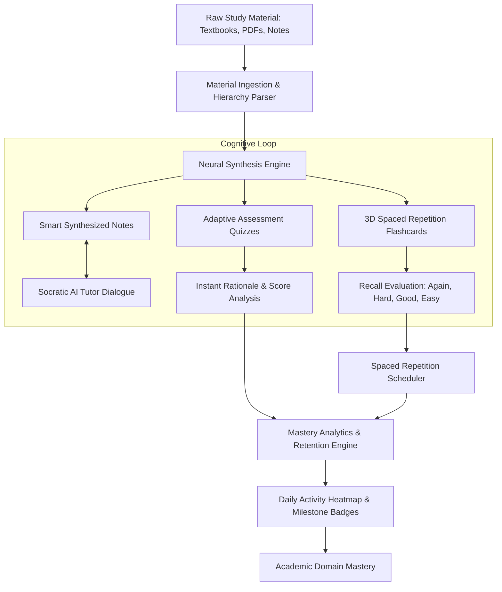
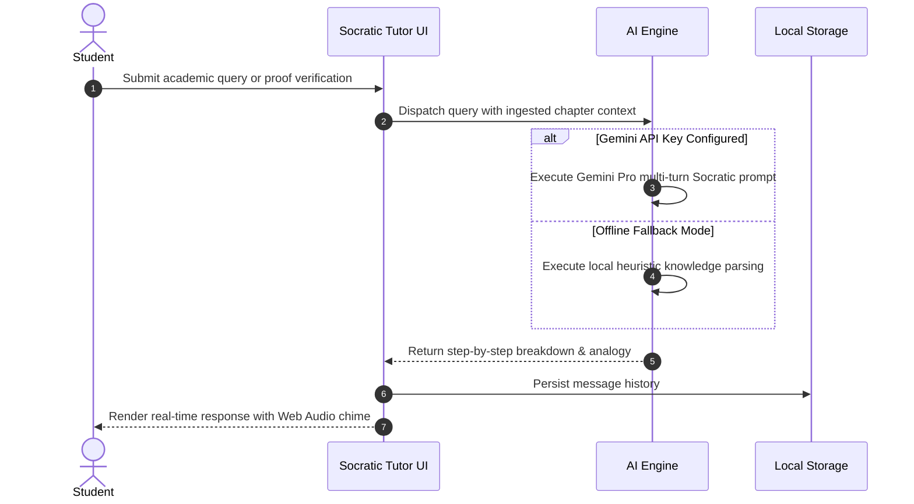

<div align="center">

# AI STUDY BUDDY®

<p align="center">
  
</p>

**Next-Generation Autonomous AI Learning Platform and Active Recall Studio**

[](https://ai-study-buddy-sooty-seven.vercel.app)
[](https://react.dev/)
[](https://www.typescriptlang.org/)
[](https://vitejs.dev/)
[](https://tailwindcss.com/)
[](https://ai.google.dev/)

**Live Application Website:** [https://ai-study-buddy-sooty-seven.vercel.app](https://ai-study-buddy-sooty-seven.vercel.app)

[Live App](https://ai-study-buddy-sooty-seven.vercel.app) • [Open Presentation Deck](#direct-document--presentation-access) • [Features](#core-capabilities) • [Architecture](#system-architecture) • [Cognitive Loop](#cognitive-study-loop) • [Setup](#getting-started)

</div>

---

## Direct Document & Presentation Access

Click on any link below to open the presentation or documentation directly in your browser:

| Document / Resource | Format | What It Contains | Direct One-Click Link |
| :--- | :--- | :--- | :--- |
| **Project Presentation (Web App)** | Interactive HTML | Complete 10-slide interactive presentation with keyboard navigation (`Arrow keys` / `Spacebar`) and dark theme. | **[Click to Open Live Presentation Deck](https://ai-study-buddy-sooty-seven.vercel.app/presentation.html)** |
| **PowerPoint Online Viewer** | Microsoft Office Online | Official 10-slide PowerPoint presentation opened directly in PowerPoint for Web without downloading. | **[Click to Open in PowerPoint Online](https://view.officeapps.live.com/op/view.aspx?src=https://raw.githubusercontent.com/panchaksharayya12/AI-Study-Buddy/main/docs/AI_Study_Buddy_Project_Presentation.pptx)** |
| **Presentation Slides (GitHub)** | Markdown (`.md`) | All 10 presentation slides formatted with cards, tables, and architecture diagrams directly on GitHub. | **[Click to View Presentation on GitHub](docs/PRESENTATION_SLIDES.md)** |
| **Technical Project Report** | Markdown (`.md`) | In-depth engineering report: architectural tiers, state hydration, procedural audio design, and benchmarks. | **[Click to Read Technical Report](docs/TECHNICAL_PROJECT_REPORT.md)** |
| **User Workflow Manual** | Markdown (`.md`) | Practical operational manual: document ingestion, Socratic prompt patterns, shortcuts, and heatmap analysis. | **[Click to Read User Workflow Manual](docs/USER_WORKFLOW_MANUAL.md)** |
| **System Architecture Diagram** | Vector SVG | High-resolution architectural blueprint detailing Presentation, State Hub, AI Engine, and Recall Suites. | **[Click to View Architecture Diagram](assets/architecture-diagram.svg)** |
| **Animated Hero Banner** | Vector SVG | Dynamic vector repository header with ambient glows, circuitry accents, and capability pills. | **[Click to View Animated Banner](assets/hero-banner.svg)** |
| **Presentation Raw Download** | `.pptx` (16:9) | Downloadable standalone Microsoft PowerPoint `.pptx` file. | **[Download PPTX File](docs/AI_Study_Buddy_Project_Presentation.pptx)** |

---

## Direct Website Deployment

The application is deployed and publicly accessible in production on Vercel:

| Environment | Direct URL | Deployment Status | Access |
| :--- | :--- | :--- | :--- |
| **Production Web Instance** | **[https://ai-study-buddy-sooty-seven.vercel.app](https://ai-study-buddy-sooty-seven.vercel.app)** | Verified Active (200 OK) | Public (Zero login required) |
| **Source Repository** | **[https://github.com/panchaksharayya12/AI-Study-Buddy](https://github.com/panchaksharayya12/AI-Study-Buddy)** | Up to Date (main branch) | Open Source (MIT License) |

---

## Overview

AI Study Buddy is an autonomous learning studio engineered to convert raw academic notes, dense textbooks, and research papers into interactive retention instruments. 

Built with a modern neo-grotesque visual design, physics-based UI transitions, and an active recall loop, the platform combines client-side Socratic AI tutoring, 3D tactile flashcards, adaptive knowledge assessments, circular Pomodoro blocks, and persistent cognitive heatmaps.

---

## Cinematic Interface

<div align="center">

### Unified Cinematic Hero

<p align="center">
  
</p>

### Central Study Dashboard

<p align="center">
  
</p>

</div>

---

## System Architecture

The platform follows a decoupled, client-first reactive architecture designed for rapid local execution, zero-cloud dependency fallback, and optional direct integration with Google Gemini Pro.

<p align="center">
  
</p>

### Architecture Breakdown

1. **Presentation & Motion Layer**
   - Single-page application built on React 18, Vite 5, and Tailwind CSS.
   - Coordinated micro-interactions orchestrated through Framer Motion spring physics.
   - Fluid requestAnimationFrame loop controller for seamless background video crossfading.
   - Consistent typography stack utilizing Outfit (Display Headings), Plus Jakarta Sans (UI Body), and Space Grotesk (Technical Identifiers).

2. **Reactive State Hub**
   - Centralized React Context API (`StudyDataContext`, `ThemeContext`, `AuthContext`).
   - LocalStorage synchronization engine ensuring state persistence across browser restarts.
   - Procedural Web Audio API sound engine providing zero-latency acoustic feedback without external audio files.

3. **Cognitive Synthesis Engine**
   - Direct client-to-API integration with Google Gemini Pro for multi-turn Socratic dialogues.
   - Embedded rule-based heuristic knowledge synthesizer functioning 100% offline.
   - Text parsing pipeline that extracts structural hierarchies, formulas, and flashcard pairs.

4. **Active Recall Execution Suite**
   - 3D CSS perspective card flipping with Leitner-inspired spaced repetition intervals.
   - Dynamic assessment bank with question rationale breakdowns and statistical grading.
   - Circular SVG Pomodoro timer synchronized with active tasks.

---

## Cognitive Study Loop

The application structures the learning process into a verified active recall loop:



### Socratic Interaction Sequence



---

## Core Capabilities

| Capability | Description | Technical Implementation |
| :--- | :--- | :--- |
| **Material Extraction** | Ingest raw documents and generate structured chapter notes with highlighted key concepts. | Client-side parser with local heuristic fallbacks |
| **Socratic AI Tutor** | Conversational tutor that provides proofs, code breakdowns, and analogies. | Google Gemini Pro REST API integration + multi-turn context |
| **3D Spaced Repetition** | Tactile 3D cards supporting standard review intervals (`Again`, `Hard`, `Good`, `Easy`). | CSS 3D perspective transforms (`preserve-3d`) + review algorithms |
| **Adaptive Quizzes** | Practice assessments with real-time scoring, timers, and in-depth answer rationales. | Automated question bank generation + accuracy tracking |
| **Focus Pomodoro** | Customizable focus blocks (`25m Focus`, `5m Short Break`, `15m Long Break`). | SVG circular stroke dasharray math + Web Audio ticking |
| **Cognitive Analytics** | Visual retention heatmaps, domain velocity indicators, and achievement milestones. | Procedural heatmap grid calculation + persistent badge states |
| **Procedural Audio** | Real-time acoustic feedback for flips, clicks, completions, and transitions. | Native Web Audio API synth oscillators (zero external audio files) |
| **Cinematic Hero** | Looping ambient video with custom 0.5s fade-in/fade-out transitions. | HTML5 video elements controlled via `requestAnimationFrame` |

---

## Technology Stack

### Frontend & Runtime
- **Runtime Environment:** Node.js (v18+)
- **Core Framework:** React 18 (TypeScript)
- **Bundler & Build Tool:** Vite 5
- **Styling Architecture:** Tailwind CSS v3 with custom glassmorphism plugins
- **Animation System:** Framer Motion (v11)
- **Presentation Engine:** PptxGenJS (for automated `.pptx` report generation)
- **Iconography:** Lucide React
- **Confetti Engine:** Canvas Confetti

### Typography System
- **Display Headings:** Outfit (Weights 700, 800, 900)
- **Body & Navigation:** Plus Jakarta Sans (Weights 400, 500, 600, 700)
- **Code & Numeric Data:** Space Grotesk (Weights 500, 600, 700)

### Sound Architecture
- **Synthesizer Engine:** Web Audio API (`AudioContext`)
- **Sound Profile:** Procedural Sine, Triangle, and Square wave synthesis (Chimes, flips, clicks, level-up fanfares)

---

## Project Structure

```
ai-study-buddy/
├── assets/                                     # Repository media and architectural diagrams
│   ├── architecture-diagram.svg                # Full system architecture vector diagram
│   ├── hero-banner.svg                         # Animated SVG header banner
│   ├── preview-hero.png                        # Screenshot of the unified hero view
│   └── preview-dashboard.png                   # Screenshot of the dashboard overview
├── docs/                                       # Project documentation & presentation suite
│   ├── PRESENTATION_SLIDES.md                  # Markdown presentation slides for direct GitHub viewing
│   ├── AI_Study_Buddy_Project_Presentation.pptx # 10-Slide executive presentation deck
│   ├── AI_Study_Buddy_Presentation_Report.html  # Self-contained interactive slide presentation
│   ├── TECHNICAL_PROJECT_REPORT.md             # In-depth technical specification report
│   ├── USER_WORKFLOW_MANUAL.md                 # Practical user guide and workflow manual
│   └── generate-ppt.cjs                        # Script to rebuild presentation slides
├── public/
│   ├── presentation.html                       # Web-hosted presentation deck on root URL
│   ├── AI_Study_Buddy_Project_Presentation.pptx # Publicly accessible PPTX file
│   └── logo.svg                                # Application brand icon
├── src/
│   ├── components/
│   │   ├── analytics/                          # Retention charts, activity heatmap, milestones
│   │   ├── auth/                               # Authentication modal & illustration
│   │   ├── common/                             # GlassCard, GlowButton, CircularProgress, Modal
│   │   ├── dashboard/                          # Primary overview, quick tools, recent chapters
│   │   ├── flashcards/                         # 3D spaced repetition card engine
│   │   ├── intro/                              # Cinematic intro sequence (session-aware)
│   │   ├── landing/                            # Cinematic hero, chapters, features, how-it-works
│   │   ├── materials/                          # Ingestion studio, chapter catalog, document reader
│   │   ├── navigation/                         # Top glass navigation bar and view router
│   │   ├── notes/                              # Synthesized smart notes & markdown editor
│   │   ├── planner/                            # Study task manager & circular Pomodoro timer
│   │   ├── quiz/                               # Adaptive assessment quiz engine
│   │   ├── settings/                           # API key configuration & audio settings
│   │   └── tutor/                              # Socratic AI tutor dialogue interface
│   ├── context/
│   │   ├── AuthContext.tsx                     # User credentials & session tokens
│   │   ├── StudyDataContext.tsx                # Application state & LocalStorage sync
│   │   └── ThemeContext.tsx                    # Sound settings & accessibility flags
│   ├── data/
│   │   └── defaultData.ts                      # Initial chapters, decks, quizzes, and tasks
│   ├── styles/
│   │   ├── fonts.css                           # Typography declarations
│   │   └── theme.css                           # Animation keyframes & cinematic styles
│   ├── types/
│   │   └── index.ts                            # TypeScript type interfaces
│   ├── utils/
│   │   ├── confetti.ts                         # Reward celebration effects
│   │   └── sound.ts                            # Procedural Web Audio API sound generator
│   ├── App.tsx                                 # Root application component
│   ├── index.css                               # Global Tailwind styles & variables
│   └── main.tsx                                # Application entry point
├── index.html                                  # HTML5 entry template & font preconnects
├── package.json                                # Project dependencies & scripts
├── tailwind.config.js                          # Tailwind design system configuration
├── tsconfig.json                               # TypeScript compiler options
└── vite.config.ts                              # Vite bundler configuration
```

---

## Getting Started

### Prerequisites
- Node.js (v18.0.0 or higher)
- npm (v9.0.0 or higher) or pnpm / yarn

### Installation

1. **Clone the repository:**
   ```bash
   git clone https://github.com/panchaksharayya12/AI-Study-Buddy.git
   cd AI-Study-Buddy
   ```

2. **Install dependencies:**
   ```bash
   npm install
   ```

3. **Start the development server:**
   ```bash
   npm run dev
   ```

4. **Access the application:**
   Open your browser and navigate to:
   ```
   http://localhost:5173/
   ```

### Production Build

To verify type integrity and compile the production bundle:

```bash
npm run build
```

To preview the production build locally:

```bash
npm run preview
```

---

## Configuration

### Optional Google Gemini Integration
AI Study Buddy includes a built-in heuristic knowledge engine that works completely offline. To enable direct live synthesis through Google Gemini Pro:
1. Open the application in your browser or visit [https://ai-study-buddy-sooty-seven.vercel.app](https://ai-study-buddy-sooty-seven.vercel.app).
2. Click the Settings icon in the navigation bar.
3. Paste your Gemini API key (obtained from Google AI Studio).
4. All AI Tutor inquiries will automatically route to Gemini Pro directly from your client without intermediary servers.

---

## License

This project is licensed under the MIT License. See the [LICENSE](LICENSE) file for details.
